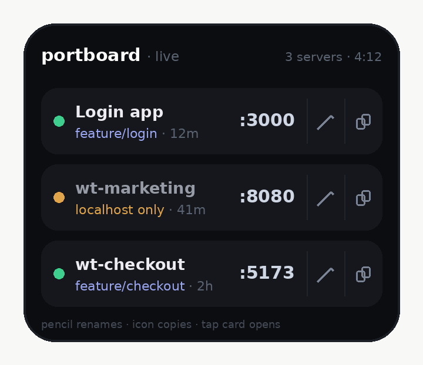

# portboard

See every local dev server on your phone. Labeled by git worktree, sorted by recency, one tap to open.

<p align="center">
  
</p>

## Why

If you run a bunch of git worktrees, each with its own dev server, the port keeps changing and you keep asking _"which port is this one again?"_ portboard watches your Mac and shows every running dev server as a tappable card on your phone, on the same WiFi. Spin up a new worktree and it just appears.

## Run it

```sh
npx portboard
```

That's the whole thing. It prints two URLs: a stable `http://your-mac.local:7878` (recommended, it keeps working even when your IP changes) and the raw `http://192.168.1.42:7878`. Open either on your phone (same WiFi), then **Share → Add to Home Screen** for an app icon.

No global install. You can also run it straight from this repo, without npm:

```sh
npx github:LeslieTou/portboard
```

## Keep it running

Make it start automatically at every login (runs in the background, restarts itself if it dies):

```sh
npx portboard install
```

Remove it:

```sh
npx portboard uninstall
```

## What you get

- **Worktree + branch labels**, not bare port numbers
- **Newest first**, so a freshly started server is always on top
- **Reachability dot**: green means your phone can open it; amber means it's bound to `localhost` only (restart that server with `--host` or `0.0.0.0`)
- **Uptime** per server, so you know if a restart actually took
- **Copy URL** and **rename** any server. Names stick to the worktree, so they survive the port changing
- **Chrome toggle** to open cards in Chrome instead of Safari on iOS
- **Add to Home Screen** for a standalone app with its own icon
- **Survives IP changes**: bookmark the `.local` URL and the card links rebuild from whatever host you opened the page on, so a new DHCP lease never breaks the bookmark

## Custom port

```sh
npx portboard 7900
```

## Requirements

macOS, Node 14+, and git. It uses `lsof`, `ps`, and `git`, which are already on your Mac. It is **read-only**: it never stops, restarts, or changes your servers.

## How it works

A tiny local HTTP server scans listening TCP ports with `lsof`, maps each one back to the folder and git worktree it's running from, and serves a mobile-friendly page bound to your LAN. One file, no dependencies. Custom names live in `~/.portboard/names.json` (hand-editable).

## License

MIT
